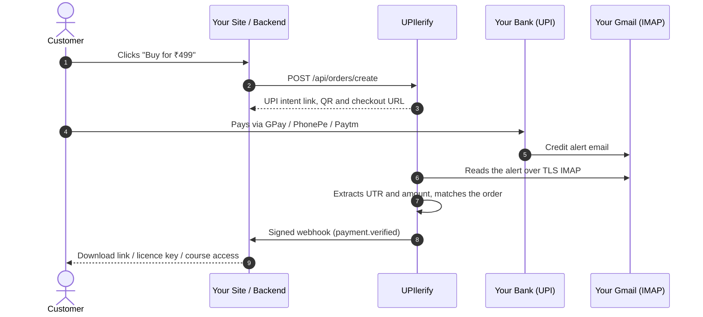

<div align="center">
  
  

  <p align="center">
    <strong>Get paid in UPI for your code, course, plugin or template. No gateway, no fees.</strong>
    <br/>
    The open-source, self-hosted UPI payment verification kit for independent creators.
  </p>

  <p align="center">
    <a href="https://github.com/harshavarma02/upilerify/blob/main/LICENSE"></a>
    <a href="https://github.com/harshavarma02/upilerify/stargazers"></a>
    <a href="https://github.com/harshavarma02/upilerify/network/members"></a>
    <a href="https://nextjs.org"></a>
    <a href="https://www.typescriptlang.org"></a>
    <a href="https://www.upilerify.online"></a>
  </p>

  <p align="center">
    <a href="https://www.upilerify.online/#sandbox"></a>
    <a href="https://www.upilerify.online/tools"></a>
  </p>

  <p align="center">
    
    <br/>
    <a href="public/demo.mp4"><sub>▶ Watch the full 1080p recording</sub></a>
  </p>
</div>

---

## ⚡ What is UPIlerify?

UPIlerify lets an independent creator accept UPI payments **straight into their own bank account** and know the moment a customer has paid, with no payment gateway in between.

Your customer pays through a standard UPI QR or app link. Your bank emails a credit alert to your Gmail. UPIlerify reads that alert over TLS IMAP, matches the amount and 12-digit UTR to the order, and sends a signed webhook to your backend. That's your cue to unlock the download, send the license key or enroll the student.

Clone it, add your keys, call three endpoints, and you're selling.

## 🎯 Perfect for

- 👨‍💻 **Developers** selling a codebase, template, boilerplate or SaaS licence
- 🎬 **Editors and designers** selling plugins, presets, LUTs or asset packs
- 🎓 **Teachers and coaches** selling a course, a cohort seat or a PDF
- ✍️ **Writers and indie makers** selling ebooks, newsletters or one-off services

If you sell something digital to individual buyers and don't want a 2% cut, a gateway signup or a waiting period, this is for you.

## ✨ Features

- 🚀 **Zero gateway fees**: payments settle directly into your bank account.
- 🧾 **Dynamic UPI QR and intent links**: one per order, with the amount and reference locked in.
- 📧 **Automatic verification from bank alerts**: reads credit-alert emails from your Gmail over TLS IMAP and extracts amount and UTR.
- 🏦 **16 banks and UPI apps recognized**: Kotak 811, HDFC, ICICI, SBI, Axis, Paytm Payments Bank, PhonePe, Google Pay, CRED, IndusInd, IDFC FIRST, PNB, Bank of Baroda, Canara, Union Bank of India and Federal Bank.
- 🔀 **Micro-offset amounts**: tiny paisa differences (₹499.01, ₹499.02) help tell simultaneous checkouts apart.
- 🔁 **UTR de-duplication**: a bank reference can only be used once.
- 🔒 **HMAC-SHA256 signed webhooks**: `payment.verified` events your backend can authenticate.
- 🛡️ **Secure by default**: API-key protected endpoints, rate limiting, SSRF-checked webhook URLs, and a server that refuses to start with weak secrets.
- 📱 **Mobile checkout page**: `/pay/[orderId]` with a one-tap UPI link.
- 📊 **Developer console**: live event stream (SSE), QR preview and IMAP connection tester.
- 💾 **SQLite persistence**: no external database to run.

## 🏗️ How it works



## 📊 UPIlerify vs. a payment gateway

| | **UPIlerify** | **Typical gateway** |
| :--- | :--- | :--- |
| **Fees** | **0% gateway fee** | Percentage fee + GST per transaction |
| **Where money goes** | **Straight to your bank account** | Via the gateway, then settled to you |
| **Signup** | **No gateway account or onboarding** | Business onboarding and verification |
| **Data** | **Self-hosted, you own it** | Vendor-hosted |
| **Setup** | **About 10 minutes** | Days to weeks |

## 🛠️ Free online UPI tools

Not ready to self-host? These free, in-browser tools at [upilerify.online](https://www.upilerify.online/tools) are useful for any UPI seller:

| Tool | What it does | |
| :--- | :--- | :--- |
| 🧮 **UPI MDR Fee Calculator** | Work out MDR fees and exemptions | [**Open →**](https://www.upilerify.online/tools/upi-mdr-calculator) |
| 💰 **UPI QR Code with Amount** | Fixed-amount QR that locks the invoice total | [**Open →**](https://www.upilerify.online/tools/upi-qr-code-with-amount) |
| 🏦 **Bank Account to UPI QR** | Turn account number + IFSC into a payable QR | [**Open →**](https://www.upilerify.online/tools/bank-account-to-upi-qr-code) |
| 💬 **WhatsApp UPI Payment Link** | One-tap payment requests for WhatsApp | [**Open →**](https://www.upilerify.online/tools/upi-link-generator) |
| ⚡ **Dynamic UPI QR Generator** | Custom QR with live preview, SVG/PNG download | [**Open →**](https://www.upilerify.online/tools/upi-qr-generator) |
| 🔍 **UPI Handles & Bank Lookup** | Search 150+ handles and find the issuing bank | [**Open →**](https://www.upilerify.online/tools/upi-handles) |
| 🛡️ **QR Code to UPI ID Extractor** | Decode any QR and check it for phishing risk | [**Open →**](https://www.upilerify.online/tools/qr-code-to-upi-id) |

> 🔒 All tools run entirely in your browser. No bank details, amounts or UPI IDs are sent to a server.

## ⚡ Quickstart

**You'll need:** Node.js 20.9+, a Gmail account with an [App Password](https://myaccount.google.com/apppasswords), a bank account that emails you on UPI credits, and a host with a persistent disk (any VPS works).

### 1. Clone and install

```bash
git clone https://github.com/harshavarma02/upilerify.git
cd upilerify
npm install
cp .env.example .env.local
```

### 2. Add your keys

Generate two secrets:

```bash
openssl rand -hex 32   # use as UPILERIFY_API_KEY
openssl rand -hex 32   # use as WEBHOOK_SECRET
```

Edit `.env.local`:

```env
# Protects your management endpoints (required)
UPILERIFY_API_KEY=paste_generated_key_here

# Signs your webhooks (required)
WEBHOOK_SECRET=paste_generated_secret_here

# Where you get paid
DEFAULT_UPI_ID=yourname@okaxis
DEFAULT_UPI_NAME="My Creator Shop"

# Gmail with an App Password (used to read bank alerts)
GMAIL_ADDRESS=yourbusiness@gmail.com
GMAIL_APP_PASSWORD=xxxx-xxxx-xxxx-xxxx

# Where payment.verified events are sent
WEBHOOK_URL=https://yoursite.com/api/webhooks/upi
```

<details>
<summary>Optional variables</summary>

| Variable | Purpose |
| :--- | :--- |
| `DATABASE_PATH` | SQLite file path (default `./data/upilerify.db`) |
| `NEXT_PUBLIC_APP_URL` | App origin (default `http://localhost:3000`) |
| `ALLOWED_DEV_ORIGINS` | Extra dev origins for Next.js |
| `WEBHOOK_ALLOWED_HOSTS` | Only allow webhooks to these hosts |
| `ALLOW_PRIVATE_WEBHOOK_TARGETS` | Dev only: allow webhooks to private addresses |

</details>

### 3. Run it

```bash
npm run dev
```

Open [http://localhost:3000](http://localhost:3000) for the developer console.

### 4. Schedule the inbox check

Have a scheduler call the sync endpoint so new bank alerts are picked up:

```cron
* * * * * curl -s -X POST http://localhost:3000/api/imap/sync -H "Authorization: Bearer YOUR_API_KEY"
```

## 💻 API

Management endpoints use `Authorization: Bearer <UPILERIFY_API_KEY>`. The checkout page and order status are public.

### Create an order

```bash
curl -X POST http://localhost:3000/api/orders/create \
  -H "Authorization: Bearer $UPILERIFY_API_KEY" \
  -H "Content-Type: application/json" \
  -d '{
    "amount": 499.00,
    "merchantUpiId": "merchant@upi",
    "merchantName": "Acme Courses",
    "useMicroOffset": true,
    "redirectUrl": "https://example.com/payment-complete?source=checkout",
    "metadata": { "userId": "usr_8819", "product": "react-masterclass" }
  }'
```

You get back the order, a `upiIntentUri` and a `checkoutUrl` to send your customer to:

```json
{
  "success": true,
  "order": {
    "id": "ord_mte75uuw_sf0z",
    "amount": 499.00,
    "expectedAmount": 499.01,
    "refNote": "ORD-89F2A",
    "status": "PENDING",
    "expiresAt": 1724946400000
  },
  "upiIntentUri": "upi://pay?pa=merchant%40upi&pn=Acme%20Courses&am=499.01&cu=INR&tn=ORD-89F2A",
  "checkoutUrl": "/pay/ord_mte75uuw_sf0z"
}
```

An optional `redirectUrl` must be an absolute HTTP(S) URL without credentials.
After bank verification, checkout opens `/pay/[orderId]/success` and shows a
3-second countdown before redirecting to the merchant with `order_id` and
`status=VERIFIED`. Existing query parameters and URL fragments are preserved;
any existing `order_id` or `status` values are replaced. Customers can also
return immediately using the link. Without a redirect URL, they stay on the
success page.

Built-in result pages are available at `/pay/[orderId]/success`, `/failed`,
`/expired`, and `/cancelled`. Verified and expired orders automatically open
their corresponding page. Failed and cancelled pages offer a return to
checkout; leaving checkout does not cancel a bank transfer or change the
order's verification status. Opening a success URL does not verify an order.
Always confirm payment on your backend using the status API or signed webhook,
not the redirect query parameters.

### Check order status

```bash
curl http://localhost:3000/api/orders/ord_mte75uuw_sf0z/status
```

### Submit a UTR (customer reference)

```bash
curl -X POST http://localhost:3000/api/verify-utr \
  -H "Authorization: Bearer $UPILERIFY_API_KEY" \
  -H "Content-Type: application/json" \
  -d '{ "orderId": "ord_mte75uuw_sf0z", "utr": "499012345678" }'
```

The order is marked `CLAIMED` and completes when the matching bank alert arrives.

## 🔔 Webhooks

When a payment is verified, UPIlerify posts this to your `WEBHOOK_URL`:

```json
{
  "event": "payment.verified",
  "timestamp": 1724945815000,
  "order": {
    "id": "ord_mte75uuw_sf0z",
    "amount": 499.00,
    "expectedAmount": 499.01,
    "utr": "499012345678",
    "bank": "HDFC Bank",
    "status": "VERIFIED",
    "metadata": { "userId": "usr_8819", "product": "react-masterclass" }
  }
}
```

Headers: `X-Upilerify-Signature` (hex HMAC-SHA256 of the raw body) and `X-Upilerify-Event`.

For ready-to-copy Python (Flask), PHP, and Go receivers with constant-time
signature comparison, see [Webhook verification examples](docs/webhooks.md).

When the periodic cleanup transitions an overdue `PENDING` order to `EXPIRED`,
it also sends a signed `order.expired` webhook to the order's saved webhook URL
(the per-order `webhookUrl`, or `WEBHOOK_URL` captured when the order was created).
The payload includes `event`, a millisecond `timestamp`, and `order` with `id`,
`amount` (the base amount), `expectedAmount`, `refNote`, `merchantUpiId`,
`status: "EXPIRED"`, and optional `metadata`. It uses the same signature scheme
and `WEBHOOK_SECRET` as `payment.verified`.

The order is saved as expired before delivery, the existing `order_expired`
SSE event is preserved, and delivery results are recorded in `webhookStatus` and the
activity log.

Verify the signature on the **raw body** before you trust the event:

```js
import crypto from 'node:crypto';

app.post('/api/webhooks/upi', express.raw({ type: 'application/json' }), (req, res) => {
  const received = req.headers['x-upilerify-signature'] || '';
  const expected = crypto
    .createHmac('sha256', process.env.WEBHOOK_SECRET)
    .update(req.body)
    .digest('hex');

  const valid =
    received.length === expected.length &&
    crypto.timingSafeEqual(Buffer.from(received), Buffer.from(expected));
  if (!valid) return res.status(401).end();

  const { event, timestamp, order } = JSON.parse(req.body.toString('utf8'));
  if (Math.abs(Date.now() - timestamp) > 5 * 60 * 1000) return res.status(400).end(); // stale

  if (event === 'payment.verified') {
    // Unlock the download, send the licence key, enroll the student...
  }
  res.json({ received: true });
});
```

For anything valuable, also confirm the amount and UTR against your bank statement.

## 🗺️ Roadmap

Contributions are very welcome on any of these. See the [open issues](https://github.com/harshavarma02/upilerify/issues) tagged `good first issue` and `help wanted`.

- [ ] SMS and notification forwarding endpoint, so any Android SMS forwarder can verify payments
- [ ] Embeddable checkout script with a modal and a one-line button
- [ ] `@upilerify/node` SDK on npm
- [ ] Ready-made "sell a course / plugin / codebase" example
- [ ] Checkout branding: your logo and colours
- [ ] Success, failed and expired pages with redirect URLs
- [ ] More banks, per-bank parsers and test fixtures
- [ ] Webhook retries with backoff
- [ ] Docker and one-command VPS deployment
- [ ] OpenAPI spec and webhook verification examples for Python, PHP and Go

## 💡 Good to know

UPIlerify is built for creators and small sellers collecting UPI payments into their own account. If you run a large or regulated business, use a licensed payment gateway. Check your bank's terms for the kind of account you collect on, and confirm important payments in your bank statement.

## 💼 Need a hand?

UPIlerify is free and open source under the [MIT License](LICENSE). If you'd like help setting it up or connecting it to your store, course platform or app:

- 🛠️ Done-for-you deployment on a VPS
- 🛍️ Shopify, WooCommerce and custom Next.js integration
- 🏦 Custom bank and wallet parsers

👉 [Book a setup call](https://www.upilerify.online/#contact) or email [`harshavarmabackup@gmail.com`](mailto:harshavarmabackup@gmail.com).

## 🤝 Contributing

Please read the [Contributing Guide](CONTRIBUTING.md) and [Code of Conduct](CODE_OF_CONDUCT.md). Found a bank alert that isn't parsed correctly? Open an issue with an anonymized sample. That's one of the most useful contributions.

## 📈 Star History

[](https://star-history.com/#harshavarma02/upilerify&Date)

---

<div align="center">
  <sub>Building in public since August 2026 · Released under the MIT License · Made with ❤️ for Indian creators and indie developers</sub>
</div>
